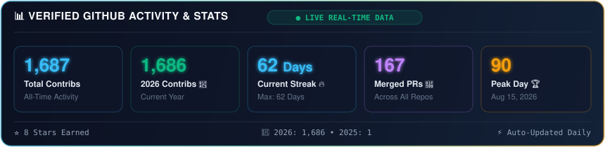

<!-- Custom Animated Header (hosted in repo, zero external downtime) -->

 

<!-- Separate Animation 1: Software Engineering -->

<!-- Separate Animation 2: Electronics & Electrical Hobbyist -->

 

---

### ⚡ What I Build

- 🧾 **Production ERP & POS Platforms** — High-speed counter billing, dual **80mm thermal / A4 PDF** invoicing, FIFO payment allocation, and double-entry ledgers.
- 📱 **Offline-First Mobile Apps** — Local-first persistence with **Drift (SQLite)** & **Dexie (IndexedDB)** paired with background cloud sync queues (**Supabase** & **Firestore**).
- 🔐 **Multi-Tenant Security** — Strict PostgreSQL **Row-Level Security (RLS)**, role-based PIN/auth guards, and immutable audit trails.
- 🔌 **Electronics & Electrical Tinkering** — Hobbyist **circuit design, soldering, microcontrollers & IoT** prototyping outside of software hours.

---

### 🔭 Currently Working On & 🌱 Learning

- 🛠️ **Building**: Offline-first POS & ERP suites (`SimpleBilling`, `simplebilling_mobile`, `MarkSea`, `Market-BIA`) and `Portfolio-Builder`.
- 🌱 **Exploring**: Advanced PostgreSQL RLS patterns, Drift/SQLite sync engines, and **STM32 / Arduino IoT** hardware automation.
- 💬 **Ask me about**: Next.js 16, Flutter + Riverpod, Supabase multi-tenancy, ESC/POS thermal printing, or circuit tinkering.

---

### 🛠️ Tech Stack

---

### 🚀 Featured Projects

#### 🌐 Public Repositories

<table>
  <tr>
    <td width="50%" valign="top">
      <h3><a href="https://github.com/RR-Alen-06/SimpleBilling">🧾 SimpleBilling</a></h3>
      
All-in-one ERP &amp; POS billing platform for print &amp; photocopy shops with dual 80mm/A4 printing, FIFO customer ledgers, advance wallets, and multi-tenant RLS.

      
<code>Next.js 16</code> <code>TypeScript</code> <code>Tailwind v4</code> <code>Supabase</code>

    </td>
    <td width="50%" valign="top">
      <h3><a href="https://github.com/RR-Alen-06/simplebilling_mobile">📱 simplebilling_mobile</a></h3>
      
Cross-platform Flutter companion app for SimpleBilling featuring an offline sync queue, thermal receipts, barcode scanning, and customer credit ledgers.

      
<code>Flutter</code> <code>Riverpod</code> <code>GoRouter</code> <code>Supabase</code>

    </td>
  </tr>
  <tr>
    <td width="50%" valign="top">
      <h3><a href="https://github.com/RR-Alen-06/PDF-Maker">📄 PDF-Maker</a></h3>
      
Offline-first Flutter utility app to convert photos &amp; camera scans into PDFs, with built-in tools to merge, split, compress, extract, and reorder pages.

      
<code>Flutter</code> <code>Riverpod</code> <code>SQLite</code> <code>Syncfusion PDF</code>

    </td>
    <td width="50%" valign="top">
      <h3><a href="https://github.com/RR-Alen-06/PrintPro">🖨️ PrintPro</a></h3>
      
React-based billing and accounting application designed for print shops with itemized billing, payment handling, customer management, and inventory tracking.

      
<code>React</code> <code>JavaScript</code> <code>Billing &amp; Accounting</code>

    </td>
  </tr>
</table>

#### 🔒 Private / In-Progress

| Project | Focus | Stack |
| :--- | :--- | :--- |
| **MarkSea** | Seasonal business management Android app (POS, Udhaar Khata, weighted-average inventory, P&L) | `React Native` `Expo` `TypeScript` `Firebase` |
| **Portfolio-Builder** | Visual portfolio studio, template engine, analytics dashboard & PDF resume exporter | `Next.js 16` `React 19` `Tailwind v4` `Supabase` |
| **Market-BIA** | Offline-first retail billing & POS with Drift/SQLite, Firestore sync & ESC/POS printing | `Flutter` `Drift` `Riverpod` `Firestore` |

---

### ⚡ Electronics & Hardware Workbench

<table>
  <tr>
    <td width="50%" valign="top">
      <h4>🔌 Microcontrollers &amp; IoT</h4>
      
Prototyping smart automation, sensor telemetry, and embedded control systems.

      
<code>STM32</code> <code>Arduino</code> <code>Sensors &amp; Relays</code> <code>Embedded C/C++</code>

    </td>
    <td width="50%" valign="top">
      <h4>🔧 Circuit Design &amp; Soldering</h4>
      
Hands-on PCB/perfboard assembly, power regulation, diagnostics, and electrical tinkering.

      
<code>Soldering</code> <code>Multimeter Diagnostics</code> <code>Power Electronics</code> <code>Prototyping</code>

    </td>
  </tr>
</table>

---

### 📊 GitHub Analytics

<!-- STATS:START -->

  
<<<<<<< Updated upstream
  
  
  
=======
  
  
  
  
>>>>>>> Stashed changes

<!-- STATS:END -->

<!-- Verified Native Stats Card (Updated Automatically via GitHub Actions) -->

 

<!-- Profile Details & Contribution Graph -->

  

<!-- Languages by Commits -->

  

<!-- Contribution Snake -->
<picture>
  <source media="(prefers-color-scheme: dark)" srcset="https://raw.githubusercontent.com/RR-Alen-06/RR-Alen-06/output/github-contribution-grid-snake-dark.svg" />
  <source media="(prefers-color-scheme: light)" srcset="https://raw.githubusercontent.com/RR-Alen-06/RR-Alen-06/output/github-contribution-grid-snake.svg" />
  
</picture>

---

### 🤝 Connect With Me

